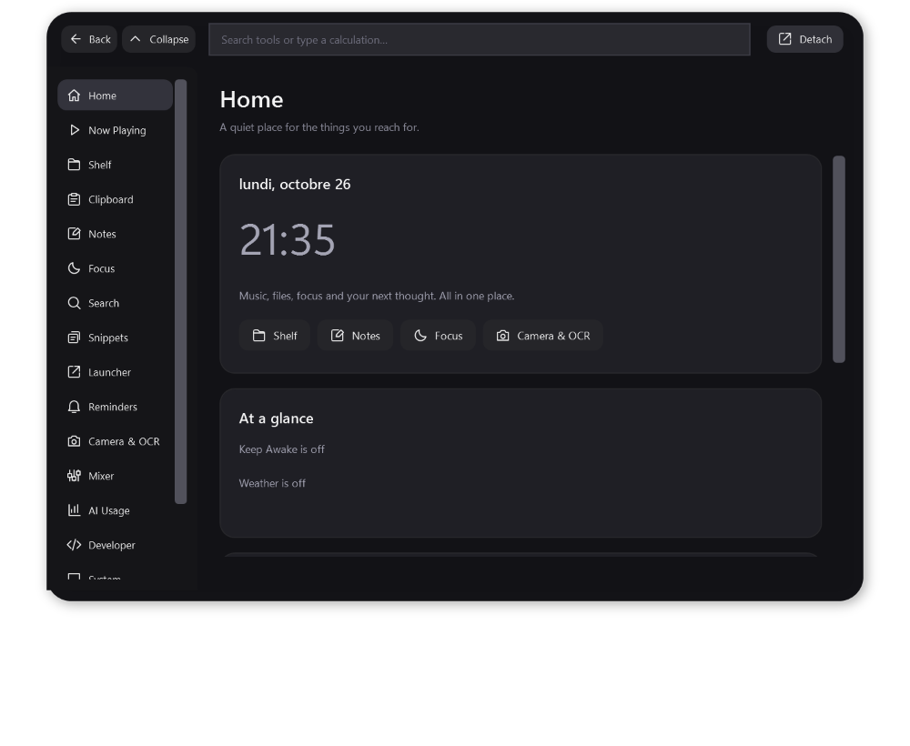

# Island 1.3 for Windows

A native C# / WPF dynamic island for Windows, with a macOS-inspired attached notch, spring motion, media controls, compact system HUDs and tools accessible directly inside the island.


[Download the latest Windows build](https://github.com/T4deusz/island-windows/releases/latest) · [Feature coverage](Feature-Coverage-1.3.md) · [Build from source](#build-from-source)

**This is a development build with partial platform integrations.** Read `Feature-Coverage-1.3.md` for an explicit item-by-item account of working functionality, Windows equivalents, partial integrations and missing/platform-specific features. The same coverage is available in Workspace > Capabilities.

## Run

1. Quit an older Island through its tray menu if it is running.
2. Download `Island-Windows-x64.zip` from [Releases](https://github.com/T4deusz/island-windows/releases/latest), extract it, and open `Island.exe` inside. Keep the runtime files together. No .NET installation is needed for this x64 build.
3. Click **Workspace** inside the expanded notch, use the tray menu, or press **Ctrl+Alt+K**. All 17 tools open directly inside the island. **Back** returns to media; **Collapse** returns to the pill; **Detach** optionally opens the current tool in a separate window. Ctrl+Alt+Space still opens/closes the island. Hotkeys can be unavailable if another app has registered them.
4. Choose attached-notch versus floating-pill mode in Settings > General. Size, display, accent and motion preferences are retained.

The portable app is an unsigned local development executable, so Windows SmartScreen may show an unfamiliar-publisher prompt. Supports Windows 10 build 19041+ and Windows 11.

## Play/pause fix

Playback state now has a separate event-driven path using Windows session and playback-info events. It updates the play/pause geometry, tooltip and accessible name independently of slow metadata/device/weather work. A successful play/pause action gets a short pending-state update until Windows confirms it; stale state is not held indefinitely. Explicit play/pause is used when supported, with toggle fallback. Switching sessions clears pending state. Shuffle/repeat/speed buttons are disabled unless the media app advertises support.

The self-checks verify distinct play versus pause rendering and accessible actions. Behavior still depends on the media app publishing accurate Windows media controls. No real playback was interrupted during automated tests.

## Workspace



The same existing feature views now live inside the island; they were refactored from the former tool window. Tool controls accept keyboard focus, scroll independently of system volume and wrap long button rows. Camera capture, mixer references, teleprompter scrolling and page refresh stop when the tool surface closes or the session locks. Tool forms stay open while editing or using a file dialog; close with Back, Collapse, Escape or Ctrl+Alt+Space. Settings remain a separate preferences window. The native window size stays fixed during both media and tool transitions; fit is recalculated for the selected display.

50 original rounded vector symbols use a shared 24-unit grid. Navigation and action buttons retain text and accessible names; icon-only controls have labels/tooltips. SVG masters are included in `Assets/Icons`, with live WPF geometry in `Icons.cs`. Play/pause state updates retain the matching icon in the media surface, hover transport and extended tools. The installed logo-design skill was applied in identity-system mode; the existing app logo is retained.

- **Home / Now Playing:** clock, quick note, optional weather, power, session notification history, extended media controls and opt-in synced lyrics.
- **Shelf:** drop files on the island; persistent references, multi-select, Alt-drag back to another app, open/reveal, screenshot staging, image conversion and ZIP tools. Removing an entry does not delete the original. References can go missing if the source file is moved. Limits: 300 shelf entries, 5,000 ZIP entries, 2 GB expanded archive content, 40 MP image conversion.
- **Clipboard:** opt-in text collection, search, pins, clear recent history while keeping pins, safe web/email/color actions. Up to 100 recent items and 200 pins. Recent text is memory-only; pins are stored locally. It respects exclusion flags provided by source apps, but cannot promise that every app excludes sensitive content. Leave it off when you do not want copied text collected.
- **Notes / Snippets / Launcher:** debounced local notes, named reusable text, and pinned apps/Windows shortcuts. Snippet copying does not insert it into Island history. No automatic text expansion or injected paste.
- **Focus:** 25-minute focus sessions, optional chained 5-minute breaks, seven-day focus-minute history, stopwatch, timed/indefinite/until-time Keep Awake. Timers/stopwatch do not survive app exit. Keep Awake is released on exit.
- **Search:** nine web engines, browser translation on explicit click and a local arithmetic calculator/history. No text is sent while typing.
- **Reminders:** local due alerts while Island is running. No iCloud or account synchronization.
- **Camera & OCR:** explicit-start local mirrored camera feed and clipboard-image OCR using installed Windows language packs. No audio capture for the camera. Leaving the page or searching commands stops the camera. Hardware/permission behavior remains untested.
- **Mixer:** real per-application Windows audio-session volume/mute and a default communications microphone mute action. Other input devices are unaffected. No equalizer driver is installed. Windows output settings are linked; a built-in output switcher is not provided.
- **AI Usage:** explicitly select a log file for Codex/Claude or a normalized Cursor/Copilot report. Shows reported tokens/cost/limits without assumed prices. Provider sections can be hidden/reordered. No credential scanning, automatic provider API access or limit alerts.
- **Developer:** opt-in loopback API, simultaneous activity reports and explicit approval decisions for clients you configure. No native Codex/Claude approval hooks are installed or bypassed.
- **System:** native CPU/memory, capture-exclusion request, download/Caps Lock toggles, Windows Hello/privacy setup links, previous-window snapping, pixel eyedropper, keyboard cleaning lock and explicit DDC/CI display brightness controls.
- **Teleprompter:** local script with adjustable scrolling. Detach the page and position it below your webcam. No Zoom integration is required.
- **Detach:** pop any workspace page into a separate resizable native window. This does not install a Windows Widgets-board extension.

## Explicit hardware controls

Camera, microphone mute, per-app volume, window snapping, pixel sampling, keyboard cleaning and DDC brightness changes happen only after a user action. Camera requests may trigger Windows permission dialogs; DDC calls require monitor/driver support and can take seconds. The cleaning lock expires after 20 seconds; **Ctrl+Alt+Esc** exits immediately, and Windows secure attention remains available. Native keyboard hooks can be blocked by elevated processes or system policy.

Notifications require the MSIX edition and Windows permission. The local API, clipboard collection and download watcher are off by default. Optional network actions include weather, lyrics, web search and browser translation.

## Notification-capable MSIX edition

`Package.ps1` can create a locally signed MSIX and public development certificate. GitHub releases currently distribute the portable app. The package declares notification-listener, global-media and webcam capabilities. No certificate or app was installed or trusted during development.

Quit older Island first. In the extracted installer folder, open PowerShell as administrator using your normal account and run:

```powershell
powershell -ExecutionPolicy Bypass -File .\Install.ps1
```

The script describes its change and requires typing `INSTALL`. It trusts the included development certificate in **Local Machine / Trusted People** and installs the package for your account. Organization policy may prevent sideloading. Open Island from Start, then connect notifications under Settings > Focus. To uninstall the package and that certificate, run `Uninstall.ps1` as administrator and type `REMOVE`. Settings are kept.

## Developer API and shell reports

Enable Workspace > Developer and copy the per-install token. It is stored encrypted for the Windows account using DPAPI. The server binds only `127.0.0.1:9999`. Nothing listens while disabled. Requests need `Authorization: Bearer <token>`; no CORS permission is granted. HTTP requests are capped at 8 KB headers / 64 KB body, 16 active connections and a three-second read deadline; up to 100 activities are retained in memory.

POST JSON to `/activities`:

```json
{"id":"my-build","title":"Building the app","kind":"build","progress":0.5}
```

Kinds: `activity`, `build`, `download`, `agent`, `approval`, `usage`, `complete`, `error`. Optional `provider`, `tokens` and `costUsd` must be reported by the client. GET `/activities` returns the current list and any user decision (`allow`/`deny`). Client-supplied decisions are ignored; updating an activity preserves a decision made in the UI. A token holder can request approval but cannot grant it through POST. These decisions apply only to integrations you write, not to native agent security controls.

The source includes `Invoke-IslandCommand.ps1`. After explicitly enabling the API and setting `ISLAND_API_TOKEN` in your shell, run:

```powershell
.\Invoke-IslandCommand.ps1 -Title 'Build' -Command { dotnet build }
```

This reports start/completion/failure. It does not modify any shell profile, install hooks, send commands to an agent, or run in the background automatically.

## Data

Settings remain in `%LOCALAPPDATA%\IslandDesktop\settings.json`. Notes, pinned clips, snippets, launcher paths, shelf references, reminders and focus history are stored in `workspace.json` in the same folder. These user-authored data are local plaintext; the API token is DPAPI encrypted in `developer-token.bin`. No token, clipboard content, local note or user log file is included in the release/source archives. Error logs are bounded. Image/ZIP output uses temporary files and commit-on-success to protect existing data.

## Validation and limits

Release compilation has zero warnings/errors. **156 self-checks** cover the original app plus media glyph state, every workspace page, arithmetic validation, URI restrictions, lyrics timing, activity validation, safe ZIP round trip/traversal rejection, PNG/PDF export and usage log parsing, in-island routing for every tool, Escape/search handling, vector geometry and accessible button state. **9 HTTP integration checks** verify authentication, malformed JSON handling, activity round trip, approval trust boundaries, oversized-request rejection/recovery and listener shutdown.

The local 1.3 performance sample measured 0.191% total collapsed idle CPU (3.828% of one logical core on a 20-thread PC) after opening and closing tools. Three media and two tool transitions averaged 92.5 render callbacks/s, p95 interval 15.01 ms and worst 30.49 ms, with zero window resizes. Render callbacks are not GPU presentation timestamps; this is not a universal 60 FPS or CPU guarantee. This sample predates the response-based spring update.

Live media/session and WASAPI loopback reads were tested. Camera/permission flow, OCR language availability, microphone or per-app volume writes, keyboard lock, DDC brightness writes, cloud/provider networking, notification consent, secure-session transitions and multi-monitor/DPI behavior remain untested end to end. The archive signature is a local development signature, not a publicly trusted publisher.

Windows secure lock-screen overlays, Apple AirDrop/Shortcuts/Reminders integration, proprietary AirPods controls and several requested provider/driver features remain unavailable or unimplemented. The coverage document names every gap; no fake prices, terminal, global privacy indicator, biometric unlock or automatic-update feed is presented as working.

Clone this repository to obtain the source. `Build.ps1 -SelfContained` builds the portable app; `Package.ps1` creates a locally signed MSIX using the Windows SDK. `Island.exe --self-test`, `--api-self-test`, `--diagnostics` and `--performance-test` produce local reports. Diagnostics can contain current track/device names; review before sharing. Preview PNGs use synthetic sample media/notes, not private live content.

References and licenses are documented in `THIRD_PARTY_NOTICES.md`. The two reference repositories were reviewed for inspiration; no Swift/fenUI renderer code, Apple fonts or assets were copied into the app.

## Motion update

Motion.cs now defines response/damping presets for Open, Close, Smooth, Snappy, Bouncy, Tracking and Release. IslandWindow selects the preset for each interaction; Gentle applies at least critical damping, and Instant/reduced motion still snap directly. Fades use smoothstep and edge swipes use the bounded rational rubber-band curve. The Windows release workflow includes these presets.

## Build from source

Requires Windows and the .NET 10 SDK. From the repository root:

```powershell
./Build.ps1 -SelfContained
```

The portable output is created in `../Island-Windows-1.3`. Keep its runtime files beside Island.exe. To run the built-in checks:

```powershell
../Island-Windows-1.3/Island.exe --self-test
../Island-Windows-1.3/Island.exe --api-self-test
```

The Windows build workflow compiles and checks the app before publishing the first `v1.3.0` portable release. Existing releases are preserved.
